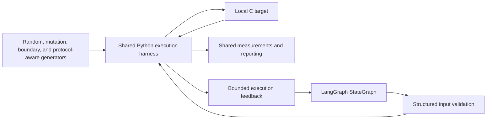

# EmbeddedFuzz-AI

*Exploring AI-Assisted Protocol Fuzzing for Embedded Systems*

> **Status: Early development — architecture and research foundation.** This repository currently contains documentation only. There is no simulator, fuzzer, agent, benchmark, or runnable setup yet.

Embedded software often accepts compact binary messages that must be parsed safely despite malformed or unexpected input. Fuzzing can exercise these parsers, but different test generation strategies may reach different behaviors at different costs.

**Research question:** Under controlled execution and resource budgets, can feedback-driven AI test generation improve discovery of reproducible failures in local synthetic protocol targets compared with random, mutation-based, boundary-value, and deterministic protocol-aware generation?

Improvement is not an assumed outcome; negative and inconclusive results are useful. The project is also a practical learning path through C parsing, Python tooling, experimental design, and bounded AI workflows.

## Research objectives

- Build a host-based C protocol target modeling a small embedded device, with a reference target intended to conform to its specification and a separate intentionally vulnerable challenge target.
- Run all generators against the same target through one bounded execution harness.
- Compare random, mutation-based, boundary-value, protocol-aware, and AI-assisted generation under both equal test-count and equal wall-clock or resource budgets.
- Report reproducible failures, known synthetic bugs found, coverage where supported, runtime, duplicate inputs, and LLM usage or cost without conflating measured facts with model interpretations.

The [research questions](docs/research-questions.md) define the proposed comparisons and their limits.

## Proposed architecture

LangGraph is proposed for planning and adaptation. Deterministic Python code will validate response formats and execution limits while allowing deliberately malformed protocol bytes to reach the target. Model output will be treated as untrusted data; model-generated code will not be executed. The [architecture document](docs/architecture.md) explains component boundaries and planned safeguards.

| Technology | Role | Current state |
| --- | --- | --- |
| Markdown and Mermaid | Project documentation and proposed architecture | In use |
| C | Local synthetic target | Planned |
| Python | Shared harness, baselines, evaluation | Planned |
| LangGraph `StateGraph` | Bounded AI-assisted test generation | Planned |
| Coverage tooling and an LLM provider | Instrumentation and optional agent inference | To be selected |

## Roadmap

- [x] **Phase 0:** Scope, proposed architecture, research plan, and public documentation.
- [ ] **Phase 1:** Documented binary protocol and local C reference and challenge targets.
- [ ] **Phase 2:** Shared execution harness, conventional baselines, saved inputs, and basic replay.
- [ ] **Phase 3:** Bounded LangGraph agent with structured output and mock-model tests.
- [ ] **Phase 4:** Coverage guidance, failure minimization, and improved deduplication.
- [ ] **Phase 5:** Reproducible benchmarking and comparison.
- [ ] **Phase 6:** Optional hardware integration.

Milestones and acceptance criteria are in the [development roadmap](docs/development-roadmap.md). The initial [protocol design](docs/protocol-design.md) is a proposal, not an implemented or finalized specification.

## Getting started

Read the [architecture](docs/architecture.md), [research questions](docs/research-questions.md), [roadmap](docs/development-roadmap.md), and [protocol proposal](docs/protocol-design.md). There are no install, build, or test commands yet. Phase 1 will introduce the first runnable target and document its setup.

## Limits and future work

The initial proposal uses one request per process and three commands without a checksum. It models parser behavior, not an MCU, peripherals, firmware timing, or interrupts. Synthetic faults and educational baselines limit what results can establish about real firmware and mature coverage-guided fuzzers. Coverage instrumentation and model variability also affect comparisons; see the [evaluation plan](docs/research-questions.md). Stateful sequences and hardware integration are future work after a reproducible local comparison exists.

Contributions should follow [CONTRIBUTING.md](CONTRIBUTING.md). This project is licensed under the [MIT License](LICENSE).
